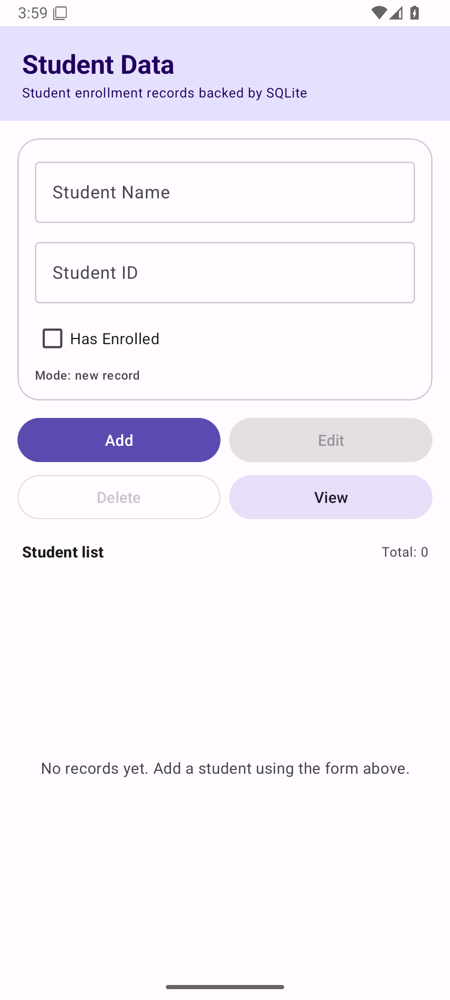
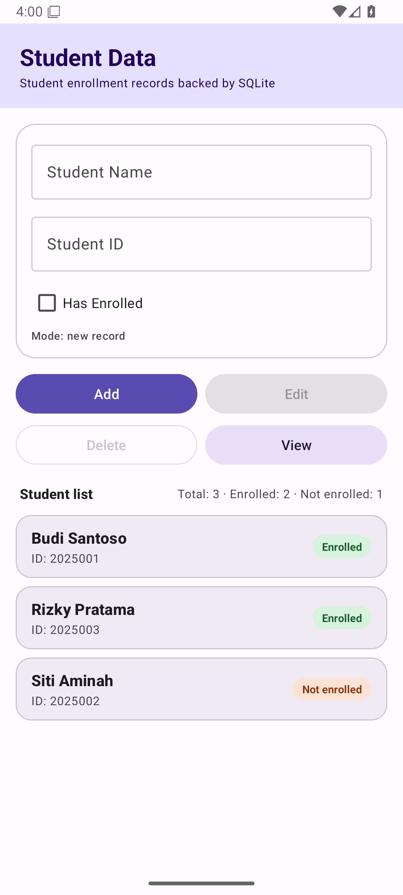
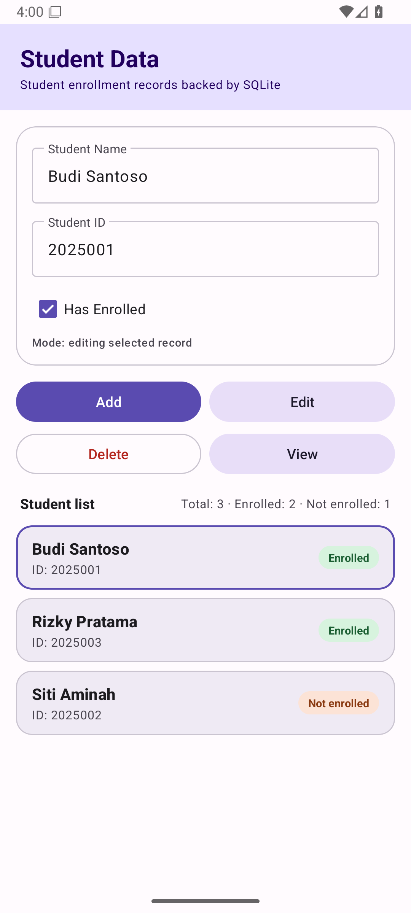

# Mid Term Mobile Application Development

Android application built for **Mid Examination IT 2025 Class 2** — Mobile Application
Development, **case 2**:

> Case 2: Student Name, Student ID, Enrolled or not

Student records are stored in an **SQLite** database, and the app provides **add, edit,
delete, and view** operations.

## Features

- Form fields: student name, student ID, and an enrollment checkbox ("Has Enrolled").
- **Add** saves a new record to the SQLite database.
- **Edit** updates the record selected from the list.
- **Delete** removes the selected record after a confirmation dialog.
- **View** reloads and displays every stored student record.
- Records are rendered in a `RecyclerView`; tap a row to select the record you want to
  edit or delete.
- Summary counters show total students, how many are enrolled, and how many are not.
- Input validation: name and student ID are required, and the student ID must be unique.

## Database schema

Database: `student_data.db` — table `students`.

| Column | Type | Description |
|---|---|---|
| `_id` | INTEGER PRIMARY KEY AUTOINCREMENT | Primary key |
| `name` | TEXT NOT NULL | Student name |
| `student_id` | TEXT NOT NULL UNIQUE | Student ID (unique) |
| `enrolled` | INTEGER NOT NULL DEFAULT 0 | 1 = enrolled, 0 = not enrolled |

## Code structure

| File | Description |
|---|---|
| `MainActivity.java` | Main screen, add/edit/delete/view flow, and form validation |
| `DatabaseHelper.java` | `SQLiteOpenHelper`: table creation and CRUD operations |
| `Student.java` | Student data model |
| `StudentAdapter.java` | `RecyclerView` adapter for the student list |
| `activity_main.xml` | Layout for the form, action buttons, and list |
| `item_student.xml` | Layout for a single student row |
| `StudentTest.java` | Unit tests for the student model |

## Screenshots

| Main screen (empty) | Student list | Editing a record |
|---|---|---|
|  |  |  |

## Verification

Checked on an Android 16 (API 36) emulator:

- Adding a record stores it in SQLite, then refreshes the list and the summary counters.
- A duplicate student ID is rejected with the inline error “Student ID is already in use”.
- Selecting a record fills the form; **Edit** updates the selected row.
- **Delete** shows a confirmation dialog and removes the row.
- Stored rows were read back directly from the `students` table in `student_data.db`.
- `./gradlew assembleDebug` and `./gradlew testDebugUnitTest` both pass.

## How to run

1. Open this folder in Android Studio (**File > Open**).
2. Wait for the Gradle sync to finish.
3. Choose an emulator or an Android device (Android 7.0 / API 24 or newer).
4. Press **Run**.

From the terminal:

```bash
export JAVA_HOME=/opt/android-studio/jbr
./gradlew assembleDebug
adb install -r app/build/outputs/apk/debug/app-debug.apk
```

## Technical specification

- Language: Java
- Android Gradle Plugin 9.4.1, Gradle 9.6.0
- `compileSdk` 37, `minSdk` 24, `targetSdk` 37
- Components: AndroidX AppCompat, Material Components 3, RecyclerView
- Data storage: SQLite through `SQLiteOpenHelper` (no third-party library)