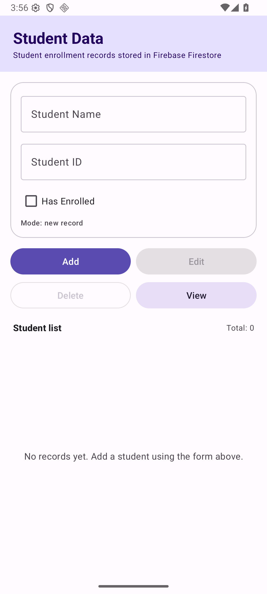
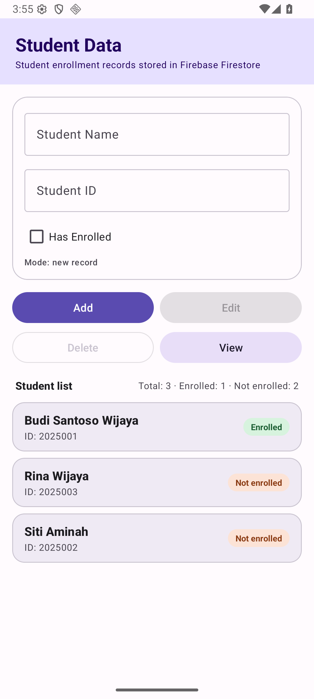
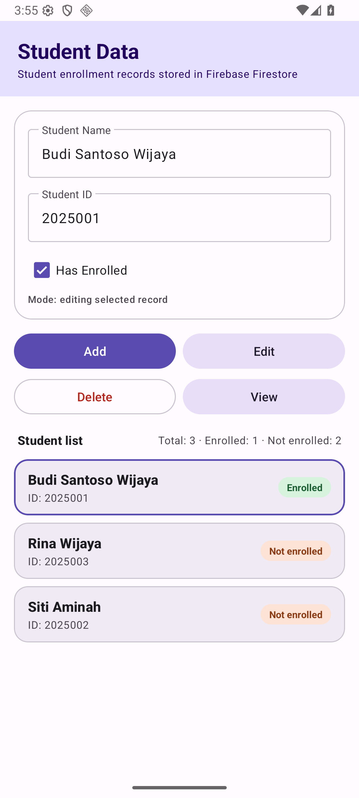

# Mid Term Mobile Application Development

Android application built for **Mid Examination IT 2025 Class 2** — Mobile Application
Development, **case 2**:

> Case 2: Student Name, Student ID, Enrolled or not

Student records are stored in **Cloud Firestore** (Firebase), and the app provides
**add, edit, delete, and view** operations.

## Features

- Form fields: student name, student ID, and an enrollment checkbox ("Has Enrolled").
- **Add** writes a new document to the `Students` collection.
- **Edit** updates the document selected from the list.
- **Delete** removes the selected document after a confirmation dialog.
- **View** reads the collection again and displays every stored student record.
- Records are rendered in a `RecyclerView`; tap a row to select the record you want to
  edit or delete.
- Summary counters show total students, how many are enrolled, and how many are not.
- Input validation: name and student ID are required, and the student ID must be unique.

## Firestore structure

Collection: `Students`. Every document holds three fields:

| Field | Type | Description |
|---|---|---|
| `name` | string | Student name |
| `studentId` | string | Student ID (unique) |
| `enrolled` | boolean | `true` = enrolled, `false` = not enrolled |

The document ID is generated by Firestore and is not stored as a field, so a student ID
can be edited without moving the record to another document. Uniqueness of `studentId` is
checked with a query before every add and edit.

## Code structure

| File | Description |
|---|---|
| `MainActivity.java` | Main screen, add/edit/delete/view flow, and form validation |
| `StudentRepository.java` | Firestore data access: add, update, delete, read, duplicate check |
| `Student.java` | Student data model mapped to a Firestore document |
| `StudentAdapter.java` | `RecyclerView` adapter for the student list |
| `activity_main.xml` | Layout for the form, action buttons, and list |
| `item_student.xml` | Layout for a single student row |
| `StudentTest.java` | Unit tests for the student model |
| `firestore.rules` | Security rules to paste into the Firebase Console |

## Firebase setup

1. Create a project in the [Firebase Console](https://console.firebase.google.com) with
   the account that owns the project.
2. **Build > Firestore Database > Create database**, choose the **Standard** edition, a
   region close to you, and start in **test mode**.
3. Open the **Rules** tab, paste the contents of `firestore.rules`, then **Publish**.
4. **Project settings > Your apps > Android**: register the package name
   `com.example.midtermapp`, then download `google-services.json`.
5. Put `google-services.json` in the `app/` directory.
6. Uncomment `alias(libs.plugins.google.services)` in `app/build.gradle.kts`, then sync
   Gradle.

The Google Services plugin stays disabled in this repository because it fails the build
when `google-services.json` is missing.

## Screenshots

| Main screen (empty) | Student list | Editing a record |
|---|---|---|
|  |  |  |

## Verification

Checked on an Android 16 (API 36) emulator:

- Adding a record writes a document to the `Students` collection, then refreshes the list
  and the summary counters.
- A duplicate student ID is rejected with the inline error "Student ID is already in use".
- Selecting a record fills the form; **Edit** updates the selected document.
- **Delete** shows a confirmation dialog and removes the document.
- Stored documents were read back from the `Students` collection in the Firebase Console.
- `./gradlew assembleDebug` and `./gradlew testDebugUnitTest` both pass.

## How to run

1. Open this folder in Android Studio (**File > Open**).
2. Wait for the Gradle sync to finish.
3. Choose an emulator or an Android device (Android 7.0 / API 24 or newer) with an
   internet connection.
4. Press **Run**.

From the terminal:

```bash
export JAVA_HOME=/opt/android-studio/jbr
./gradlew assembleDebug
adb install -r app/build/outputs/apk/debug/app-debug.apk
```

## Technical specification

- Language: Java
- Android Gradle Plugin 9.4.1, Gradle 9.6.0
- `compileSdk` 37, `minSdk` 24, `targetSdk` 37
- Components: AndroidX AppCompat, Material Components 3, RecyclerView
- Data storage: Cloud Firestore through the Firebase BoM 35.1.0
